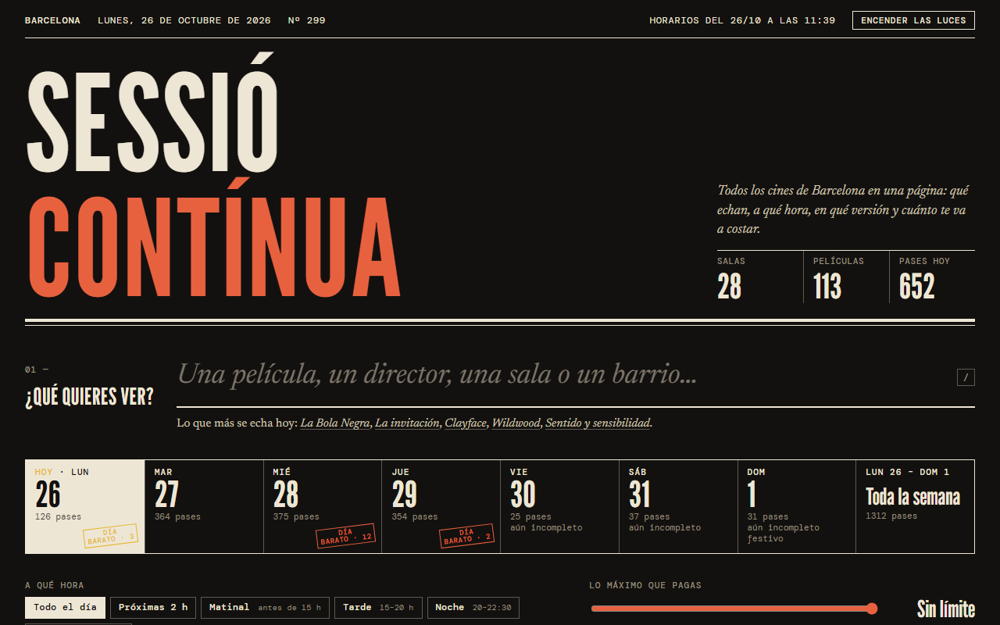

<div align="center">

# Sessió Contínua

**La cartelera de todos los cines de Barcelona en una sola página:**
qué echan, a qué hora, en qué versión y cuánto cuesta cada sesión.




</div>

---

## Qué es

Sessió Contínua reúne en una única web estática la cartelera de **28 salas** de Barcelona y alrededores
(más de **100 películas** y cientos de pases por semana), con el precio real de cada entrada.
Sin backend, sin framework, sin build: un `index.html` que lee dos ficheros de datos generados por scripts de Python.

## Funciones

- **Búsqueda instantánea** por película, director, sala o barrio (atajo `/`).
- **Selector de día** con recuento de pases, marcas de «día barato» y festivos, y vista «Toda la semana».
- **Filtros combinables:** franja horaria (matinal, tarde, noche, golfa), precio máximo, versión (VO, doblada, catalán), formato (3D, IMAX, 4DX…) y zona.
- **Precio por sesión** calculado con la tarifa de cada cine: día del espectador, festivos, matinales y suplementos por formato. Si una tarifa no es fiable se muestra como orientativa.
- **Cerca de mí:** ordena por distancia a un barrio o a tu ubicación (geolocalización opcional, no sale del navegador).
- **Plano de Barcelona** propio, girado 45° (montaña arriba, mar abajo), generado a partir de OpenStreetMap.
- **Ficha de película y de sala** con direcciones, transporte y enlace a Google Maps.
- **Modo claro/oscuro** («Apagar las luces») que recuerda tu preferencia y respeta la del sistema.
- Aviso de qué días aún tienen horarios incompletos y qué salas no publican sesiones.

## Estructura

```
sessio-continua/
├── index.html               # La web completa (HTML + CSS + JS, sin dependencias)
├── data/
│   ├── cartelera.js         # Cartelera, cines, precios y sesiones  (generado)
│   └── mapa.js              # Plano de Barcelona                    (generado)
├── actualizar_cartelera.py  # Recoge los horarios y regenera cartelera.js
├── generar_mapa.py          # Descarga y proyecta el plano; se ejecuta una vez
├── wrangler.jsonc           # Despliegue en Cloudflare Workers (assets estáticos)
└── docs/captura.png
```

## Uso en local

No hay nada que instalar. Abre `index.html` en el navegador, o sírvelo con cualquier servidor estático:

```bash
python -m http.server 8080
# http://localhost:8080
```

## Actualizar la cartelera

Requiere Python 3.10+ y solo usa la librería estándar.

```bash
python actualizar_cartelera.py            # 7 días desde hoy
python actualizar_cartelera.py --dias 4
python actualizar_cartelera.py --desde 2026-11-02
```

Reescribe `data/cartelera.js`. Fuentes de horarios:

| Fuente | Cubre |
| --- | --- |
| Sensacine | Casi todos los cines comerciales de Barcelona y alrededores |
| cinemamalda.com | Cinema Maldà |
| espaitexas.cat | Espai Texas |
| Programa mensual (PDF) de la Filmoteca de Catalunya | Filmoteca (necesita `pdftotext`, incluido en Git for Windows y poppler; si falta, se omite) |

> **Sobre los precios:** no salen de ninguna API. Son las tarifas publicadas de cada cine, anotadas a mano
> en la lista `CINES` de `actualizar_cartelera.py`, cada una con su fuente y fecha de comprobación.
> Conviene revisarlas de vez en cuando.

### Regenerar el plano

```bash
python generar_mapa.py
```

Descarga de OpenStreetMap (Overpass) los distritos, municipios vecinos, vías principales, parques y ríos,
y los proyecta en un plano propio. Solo hace falta ejecutarlo una vez.

## Despliegue

Pensado para **Cloudflare Workers con assets estáticos**. Conecta el repositorio desde el panel de Cloudflare
(Workers & Pages → Create → Import a repository) o despliega a mano:

```bash
npx wrangler deploy
```

`wrangler.jsonc` sirve la raíz del repo y `.assetsignore` deja fuera scripts, documentación y metadatos.
### Actualización automática

El workflow [`.github/workflows/actualizar-cartelera.yml`](.github/workflows/actualizar-cartelera.yml)
ejecuta `actualizar_cartelera.py` cada día a las ~05:00 (Barcelona) en GitHub Actions y hace commit de
`data/cartelera.js`; Cloudflare redespliega solo con cada push. También se puede lanzar a mano desde
la pestaña **Actions → Actualizar cartelera → Run workflow**.

Si el resultado parece incompleto (muy pocas sesiones, o muchas menos que la cartelera anterior) el script
sale con error y **no sobrescribe nada**: la web sigue con los datos del día anterior y GitHub avisa por email.
Se puede saltar la comprobación con `--forzar`.

## Créditos y datos

- Horarios: Sensacine, Cinema Maldà, Espai Texas y Filmoteca de Catalunya.
- Plano: © colaboradores de [OpenStreetMap](https://www.openstreetmap.org/copyright) (ODbL).
- Tipografías: League Gothic, Newsreader y DM Mono (Google Fonts).
- Sessió Contínua no tiene relación con ninguno de los cines ni servicios citados.

## Licencia

[MIT](LICENSE) © 2026 Moisés García Poveda
